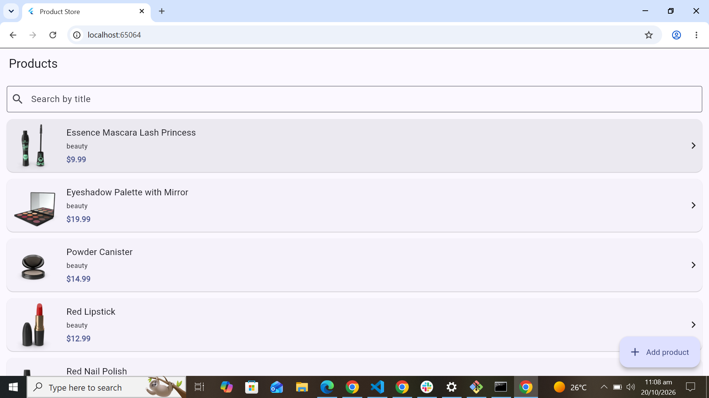
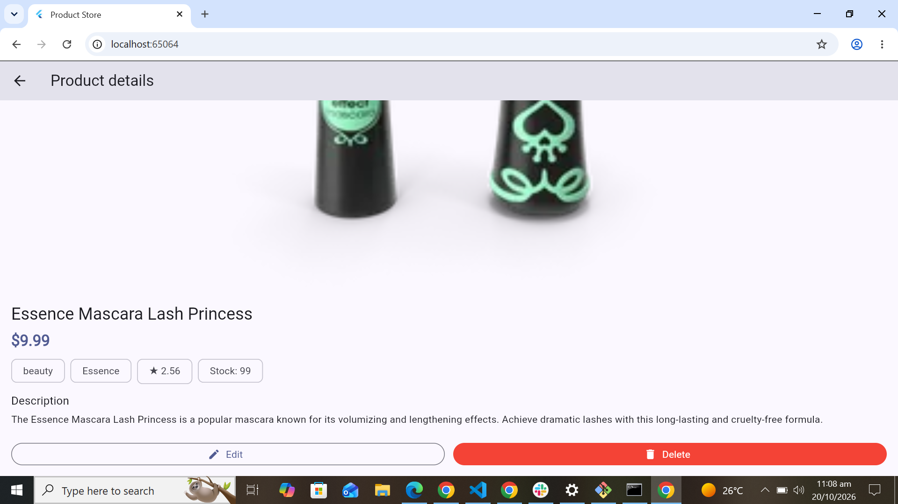
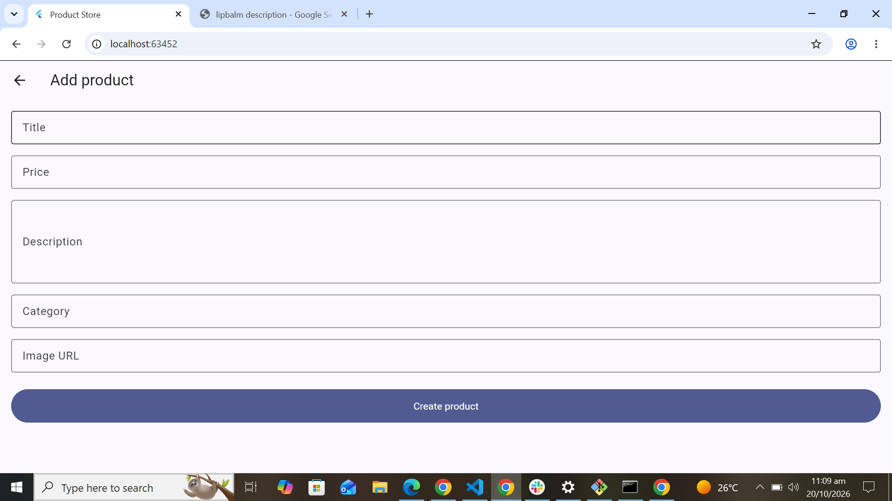
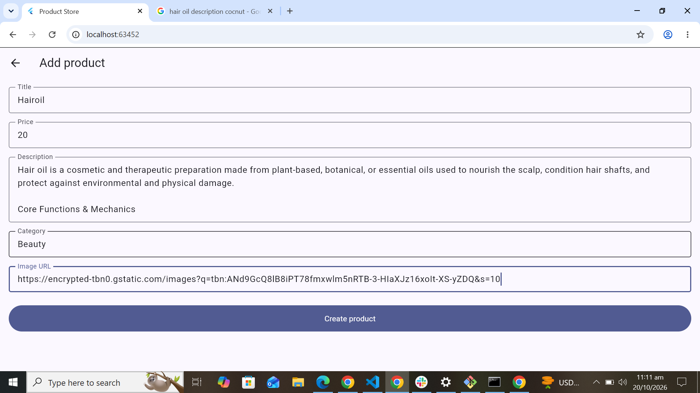
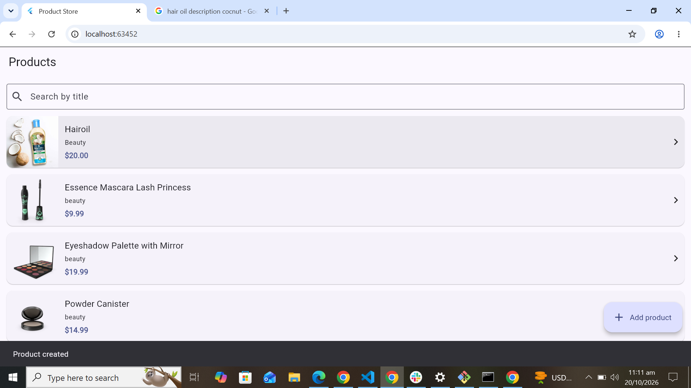
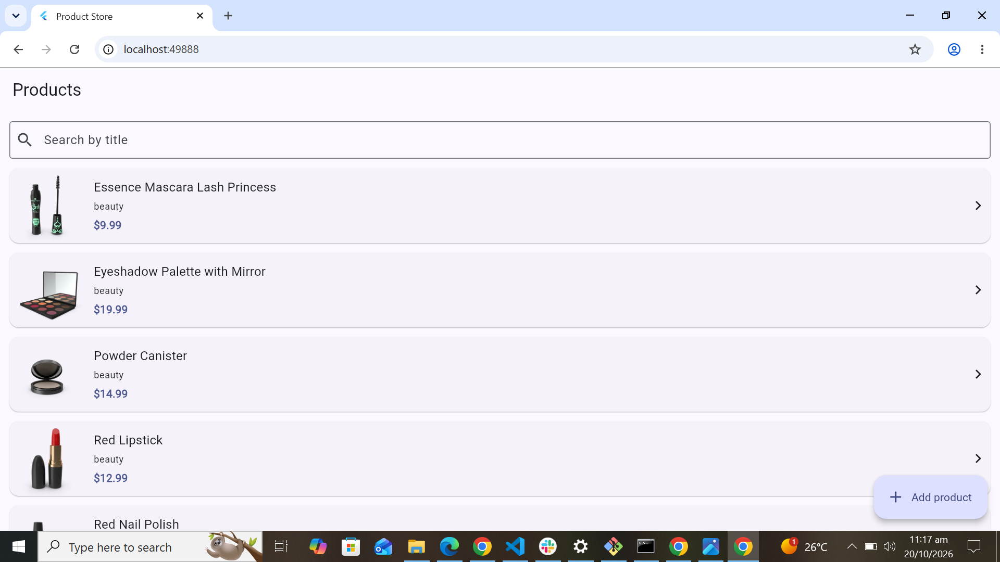
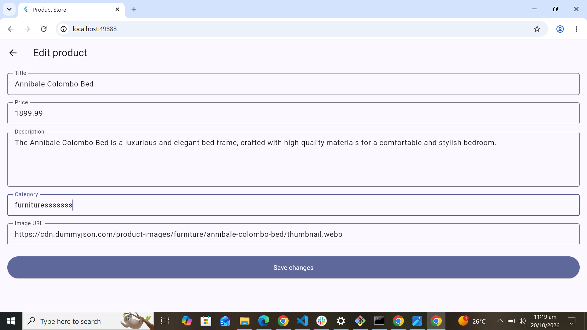
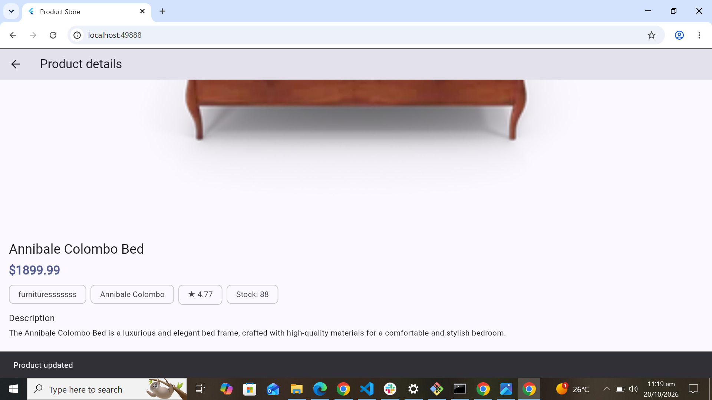
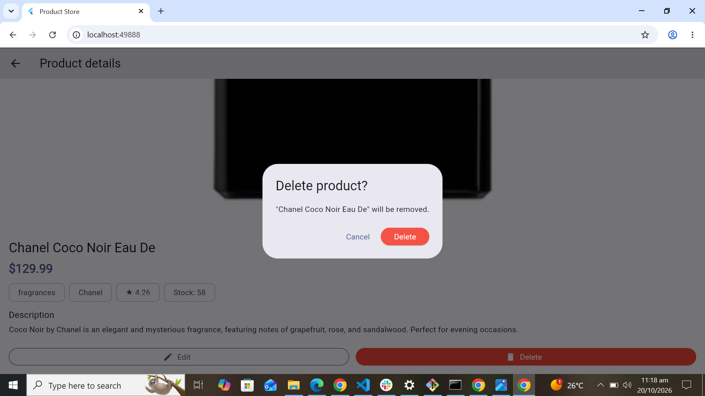

# Product Store App

A Flutter application built to practise CRUD (Create, Read, Update, Delete) operations using the DummyJSON Products REST API. No custom backend is used.

## Features

- Fetch and display products with image, title, price, and category
- Search products by title
- Pull down to refresh the product list
- View complete product details
- Add new products (POST)
- Edit existing products (PATCH)
- Delete products with a confirmation dialog
- Validate form inputs, including product price
- Display loading, error, and empty states
- Show success and error feedback using SnackBars
- Handle API errors and asynchronous requests safely

## Tech Stack

- Flutter and Dart
- [Dio](https://pub.dev/packages/dio) for HTTP requests
- [DummyJSON Products API](https://dummyjson.com/docs/products)
- Flutter built-in state management using `setState`

## Android Internet Permission

The app uses the DummyJSON REST API to fetch and manage product data, so internet access is required.

Make sure `android/app/src/main/AndroidManifest.xml` contains the following permission inside the `<manifest>` tag and outside the `<application>` tag:

```xml
<uses-permission android:name="android.permission.INTERNET"/>
```

This permission allows the Android app to access the internet when a network connection is available.

## API Documentation

Base URL: https://dummyjson.com

| Operation | Method | Endpoint |
|---|---|---|
| Get products | GET | `/products?limit=100` |
| Get product details | GET | `/products/{id}` |
| Add product | POST | `/products/add` |
| Update product | PATCH | `/products/{id}` |
| Delete product | DELETE | `/products/{id}` |

### Example request body

```json
{
  "title": "Sample product",
  "description": "A short description",
  "price": 19.99,
  "category": "beauty",
  "thumbnail": "https://example.com/image.png"
}
```

## Getting Started

### Prerequisites

- Flutter SDK (includes Dart)
- Visual Studio Code or another Flutter-compatible IDE
- An emulator, physical device, or Chrome
- An internet connection

### Installation

Clone the repository:

```bash
git clone https://github.com/AreebaWaqar57/flutter-product-store-app.git
cd flutter-product-store-app
```

Install dependencies:

```bash
flutter pub get
```

Run the application:

```bash
flutter run
```

To run on Chrome:

```bash
flutter run -d chrome
```

## Project Structure

```text
product_store/
├── lib/
│   ├── main.dart
│   ├── models/
│   │   └── product_model.dart
│   ├── services/
│   │   └── product_api_service.dart
│   ├── screens/
│   │   ├── products_screen.dart
│   │   ├── product_details_screen.dart
│   │   └── product_form_screen.dart
│   └── widgets/
│       ├── product_card.dart
│       ├── loading_widget.dart
│       └── error_widget.dart
├── screenshots/
├── test/
├── android/
├── ios/
├── web/
└── pubspec.yaml
```

## Important Note About DummyJSON

DummyJSON simulates product creation, updates, and deletion. Changes are not permanently saved on its server.

The app updates its local UI after successful operations. Refreshing the product list fetches server data again, so local changes may disappear.

## Testing

- Load and refresh the product list
- Search for existing and nonexistent products
- Open product details
- Add a product with valid data
- Edit a product
- Delete a product and test cancellation
- Submit an empty form
- Enter an invalid or non-positive price
- Disconnect the internet to test error handling

## Screenshots

### Product list and details




### Create a product (POST)






### Update a product (PATCH)




### Delete a product (DELETE)



## Learning Outcomes

- REST API integration in Flutter
- JSON serialization and deserialization
- Separation of models, services, screens, and reusable widgets
- Form validation and error handling
- Asynchronous programming with `async` and `await`
- Navigation and local UI updates
- Git and GitHub workflow

## Author

Areeba Waqar